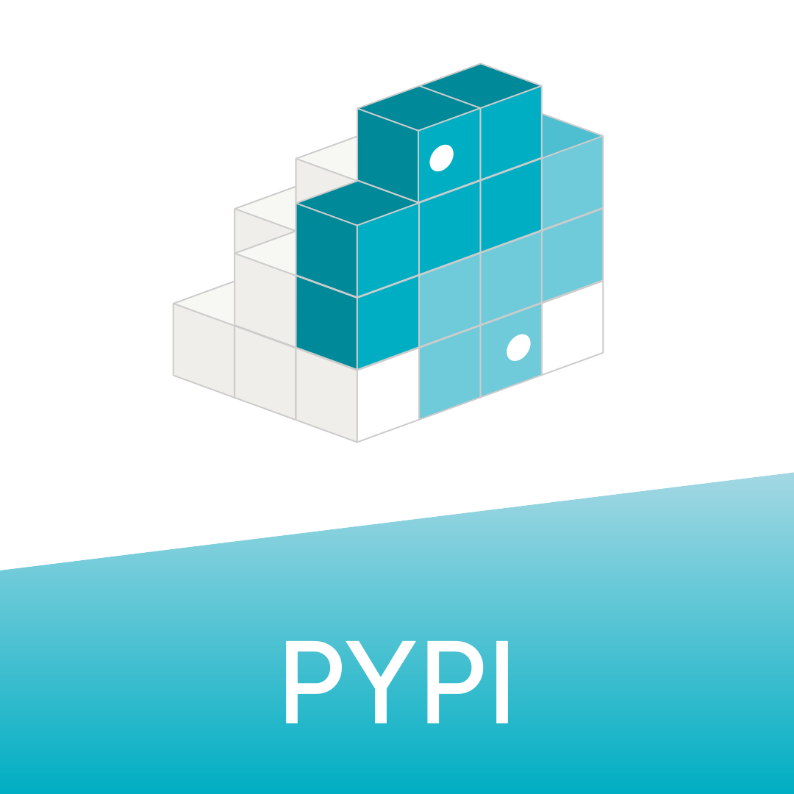

```{image} img/assets/opi_logo_horizontal.svg
:align: center
:alt: ORCA Python Interface
:width: 500
```

# ORCA Python 接口（OPI）

这里提供 ORCA Python 接口（OPI）的使用教程。OPI 用于访问量子化学程序包
[ORCA](https://www.faccts.de/orca/) 的功能，因此建议同时查阅
[ORCA 手册](https://www.faccts.de/docs/orca/6.0/manual)，了解 ORCA 实现的方法。
也建议加入 [ORCA 论坛](https://orcaforum.kofo.mpg.de/app.php/portal)，
就 ORCA 本身的具体问题和已知问题获取帮助。

## 实用链接

::::{grid} 3
:::{grid-item-card}
[](contents/api/index)
:::
:::{grid-item-card}
[](https://www.faccts.de/docs/orca/6.1/manual/)
:::
:::{grid-item-card}
[](https://www.faccts.de/docs/orca/6.1/tutorials/)
:::
::::
::::{grid} 3
:::{grid-item-card}
[](contents/notebooks/how_to_opi.ipynb)
:::
:::{grid-item-card}
[](https://pypi.org/project/orca-pi/)
:::
:::{grid-item-card}
[](https://github.com/faccts/opi)
:::
::::

```{toctree}
:caption: 文档
:maxdepth: 2

contents/versions
contents/how_to_cite
contents/install
contents/api/index
```

```{toctree}
:caption: 开发
:maxdepth: 1

contents/how_to_contribute
contents/dev_guide
```

```{toctree}
:caption: 教程
:maxdepth: 1

contents/notebooks/how_to_opi.ipynb
contents/notebooks/ml_properties.ipynb
contents/notebooks/conformer_generation.ipynb
contents/notebooks/redox.ipynb
contents/notebooks/fock_matrix_diagonalization.ipynb
contents/notebooks/led.ipynb
contents/notebooks/covaled_ethane.ipynb
contents/notebooks/adld_dftd4.ipynb
contents/notebooks/adld_hfld.ipynb
contents/notebooks/atomic_fukui_indices.ipynb
contents/notebooks/ir_spectrum.ipynb
contents/notebooks/extopt.ipynb
contents/notebooks/opencosmors.ipynb
contents/notebooks/moplot.ipynb
```

```{toctree}
:caption: 社区示例
:maxdepth: 1

contents/notebooks/extrapolate_cps_cbs.ipynb
contents/notebooks/extrapolate_ep1.ipynb
contents/notebooks/wb97m2.ipynb
contents/notebooks/chemeleon_orca.ipynb
contents/notebooks/deep_learning_barrier_heights.ipynb
```

[documentation]: index.html
[tricks and tips]: index.html
